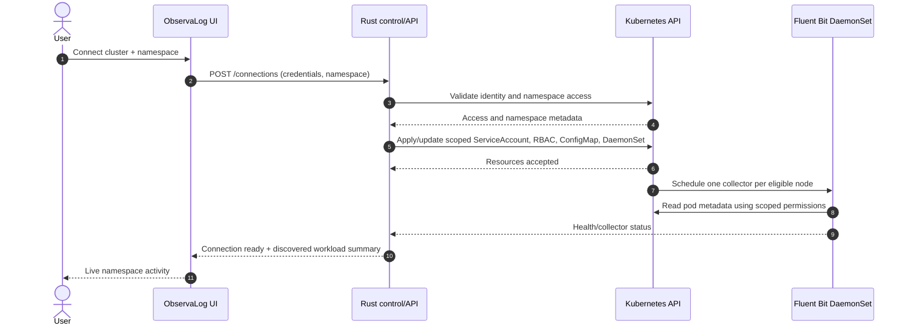
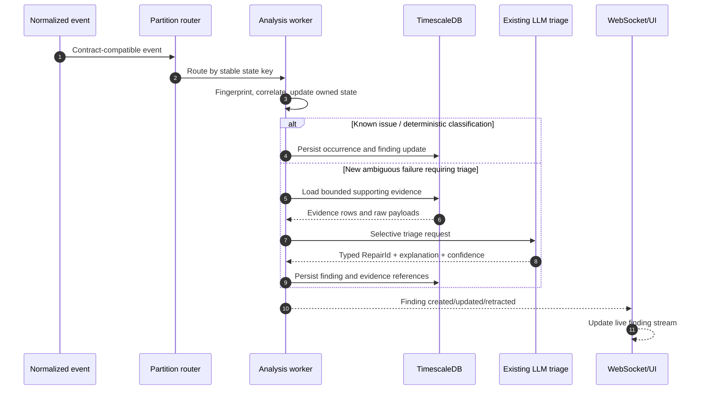
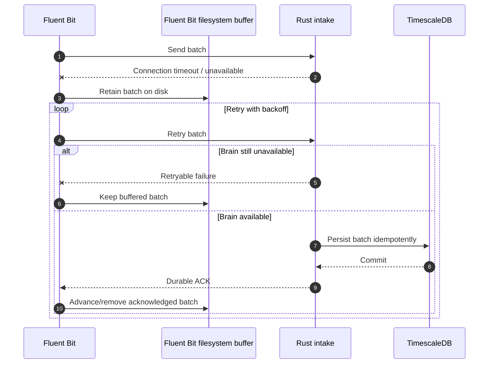
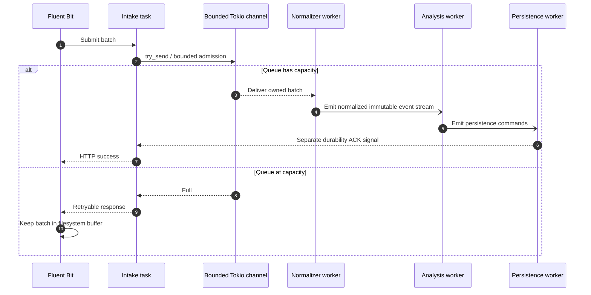

# ObservaLog — Sequence Diagrams

These diagrams describe the target flow. They are design contracts for implementation phases, not claims that the behavior is already implemented.

## Pipeline invariant: asynchronous stream gates

All event-processing gates are independently progressing stream processors. Each gate consumes, processes and emits without a synchronous cross-gate round trip. Internal communication uses bounded asynchronous queues/streams. Durable delivery ACKs are protocol signals tied to the explicit acceptance boundary; they do not make downstream analysis a synchronous dependency. Backpressure is explicit, bounded and may propagate upstream.

## 1. Connect a Kubernetes namespace



Notes:
- The collector is node-level because container log files are node-local.
- Namespace selection is enforced in collector configuration; the brain still validates namespace identity on received events.
- The exact credential hand-off and RBAC manifest are security-reviewed in Phase 2.

## 2. Continuous pod/container log discovery

```mermaid
sequenceDiagram
    autonumber
    participant Kubelet
    participant FS as Node log filesystem
    participant FB as Fluent Bit tail input
    participant K8s as Kubernetes metadata filter
    participant Brain as Rust HTTP intake

    Kubelet->>FS: Create/update container log symlink and CRI log file
    loop Continuous file discovery and tail
        FB->>FS: Discover matching file / read new bytes
        FS-->>FB: CRI records
        FB->>FB: Parse runtime envelope and reconstruct multiline records
        FB->>K8s: Enrich record using pod/container identity
        K8s-->>FB: Namespace, pod, container, node, labels
        FB->>FB: Apply namespace filter and batch records
        FB->>Brain: POST compressed log batch
        Brain-->>FB: ACK after durable acceptance
    end

    Note over Kubelet,FB: New pod/container files are discovered automatically; no per-pod Rust task is required.
```

## 3. Normalize an arbitrary log into the existing contract

```mermaid
sequenceDiagram
    autonumber
    participant FB as Fluent Bit
    participant Intake as Rust HTTP intake
    participant Parse as Normalizer
    participant Adapter as Contract adapter v1
    participant Brain as Existing brain pipeline
    participant DB as TimescaleDB

    FB->>Intake: Batch of raw records + Kubernetes metadata
    Intake->>Intake: Validate size, source and batch envelope
    Intake-)Parse: Async bounded hand-off
    Parse->>Parse: Detect JSON / text / severity / timestamp / exception
    Parse-)Adapter: Async stream of parsed fields + raw evidence + provenance
    Adapter->>Adapter: Map known values; mark missing fields unknown/synthetic
    Adapter-)Brain: Async contract-compatible event stream
    Brain-)DB: Batched asynchronous persistence
    DB-->>Brain: Commit signal
    Brain-->>Intake: Durable acceptance signal (protocol ACK path)
    Intake-->>FB: HTTP success
```

Rules:
- Real trace/span/sequence/outcome values are preserved only when present in source evidence.
- Synthetic placeholders are provenance-marked and excluded from trace reconstruction/gap detection.
- Raw log content and collector metadata remain available for investigation.
- A batch is not ACKed merely because it entered an in-memory Tokio channel.

## 4. Evidence-to-finding flow



## 5. Collector and brain recovery



The delivery guarantee is at-least-once with idempotent ingestion. A durable-acceptance boundary and duplicate-key design are release gates before removing Kafka.

## 6. Backpressure and worker isolation



No worker writes into another worker's mutable state. Queue saturation is visible and propagates upstream; it must not turn into unbounded memory growth or silent log loss.
